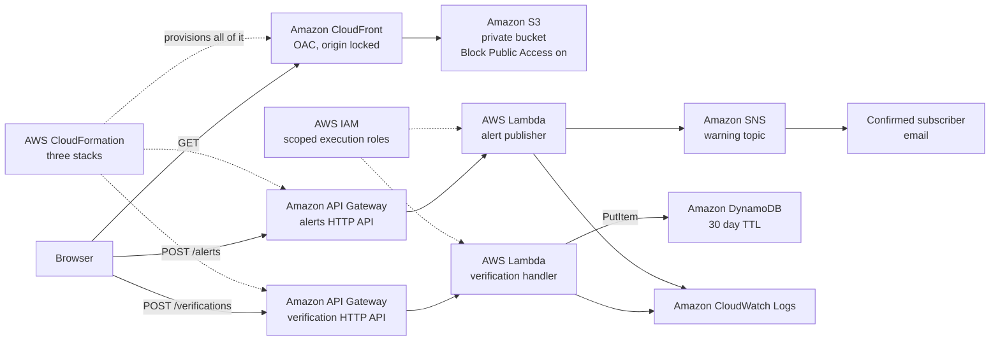

# PLUVIA

**Know the Impact, Not Just the Rain.**

A weather app tells you it will rain 40 mm tomorrow. It does not tell you that the corner you
walk past every morning held twenty two inches of water for almost five hours, and that it has
done that on four of the last forty days that rained as hard.

PLUVIA answers the second question. You pick a place, it watches that place, and when the
forecast looks like the days that flooded it before, it warns you and shows you the count the
warning was built from.

---

## What it does

1. **Pick a place.** Zoom the map to your street and click it, search a ZIP code, borough or
   street name, or press the locate button. The pin moves and the search box fills in.

2. **Watch it.** One button. PLUVIA keeps that place in your browser, pulls the public rain
   forecast for the next seven days, and checks every forecast day against what the nearest
   measured record says happened at that point on comparable rain days.

3. **Get a warning with its arithmetic attached.** A warning never arrives as a bare colour.
   It arrives as a sentence you can check: *of the 40 days since this sensor was installed that
   rained 30 mm or more, water was recorded here on 4 of them, with a typical depth of
   21.9 in / 56 cm.* Rain amounts are in millimetres, water depth is in inches and centimetres.

4. **See the live evidence underneath.** The card shows the current temperature and rainfall
   for that point, the heaviest stretch in the next 48 hours with its clock window, a 48 hour
   rain chart, and the 311 drainage complaints logged within 300 m, read live from NYC Open
   Data at the moment you look.

5. **Have it emailed.** One button sends that warning through an AWS endpoint to an Amazon SNS
   topic, which delivers it to the confirmed subscriber.

6. **Check a what-if, and replay a real storm.** Choose any rain amount and duration and see
   the same count for it. For events that carry a stored depth profile, the timeline plays back
   minute by minute from the recorded values at the recorded timestamps.

7. **Add what the sensors cannot see.** A sensor measures one point. The verification form lets
   a person who was there record what they saw, through a live AWS endpoint.

---

## What a warning is, and what it is not

PLUVIA issues warnings. It is an early warning product and that is the point of it.

What it will not do is pretend to be something it is not:

- **The warning is counted, never modelled.** PLUVIA takes the published forecast, finds the
  days in that location's own measured record that rained as hard, and counts how many of them
  put water on the ground. That count is printed next to the warning. If the count is thin, the
  card says the evidence is thin.
- **It is threshold triggered, not a 24/7 live feed.** FloodNet does not publish a live public
  API. What exists is a periodic snapshot of recorded flood events, and that snapshot is what
  the history is built from. The forecast and the 311 complaints are live. The flood history is
  dated and the date is on screen.
- **It does not invent depth.** Every depth shown is a value a sensor actually measured. The
  deepest reading in the whole dataset is 46.14 in / 117 cm, at `Q - 183rd St/90th Ave` on
  2026-05-20. Nothing above that is ever produced, because nothing above that was ever recorded.
- **The scoring runs in your browser,** against a dated snapshot served from Amazon S3 through
  CloudFront. Moving that step into Lambda is the next piece of work, and the rule is written as
  pure functions so it moves without a rewrite.

A warning that cannot be checked is worse than no warning. So every one of them ships with the
number of days it was counted from.

---

## What it refuses to do

This is the part we are most proud of. A system that answers every question is a system that is
guessing at some of them.

| Situation | What PLUVIA says |
| --- | --- |
| Tidally influenced sensor | **Rainfall verdict refused.** `Q - Beach 84 St` has 388 recorded flood days, but the median rainfall on those days was 0.6 mm. The water there is the tide. A rainfall percentage would be a confident number from the wrong cause. |
| Water too shallow to matter | **No warning.** A place whose typical reading is under 2 in never raises one, however often it gets wet. `BX - Tibbett Ave/W 230th St` floods on 40 percent of 20 mm days and is still refused, because its deepest reading in 42 flood days is 1.85 in. |
| Sensor with no recorded history | **Verdict unavailable.** A sensor with no history is not the same as a safe location, and the page will not imply it is. |
| Fewer than 20 comparable rain days | The percentage is shown with an explicit caution that the evidence is thin. |
| Any missing value | Rendered as `[UNKNOWN]` or `Unavailable`. Never zero filled, never interpolated. |

### The refusal that is actually a finding

`BX - Tibbett Ave/W 230th St` is refused a depth warning, and in the same card PLUVIA shows why
it still matters: water appears there on days with as little as 3.1 mm of rain, and NYC 311 has
32 drainage complaints logged within 300 m of it, 31 of them closed, the last cleared on
2026-08-17. Two independent public datasets agree that this is a drainage problem, not a
rainfall problem. Shallow water is not a reason to stay quiet. It is a reason to say something
different.

### Why an average over a route is meaningless

`BK - Carroll St/4th Av` and `BK - 4th Av/Garfield Pl` are **49 metres apart**. Both were
installed on the same day, 2021-07-15. Both have been measuring for the same 1,914 days.

| Sensor | Days with water | Typical depth | Deepest |
| --- | --- | --- | --- |
| `BK - 4th Av/Garfield Pl` | 4 | 2.3 in / 6 cm | 16.42 in / 42 cm |
| `BK - Carroll St/4th Av` | 10 | 21.9 in / 56 cm | 35.94 in / 91 cm |

Same avenue, same install date, same measurement window, nine times the water in fifty metres.
This is why PLUVIA scores the exact point you pinned and will not smear a figure across a
neighbourhood.

---

## Where AWS is used

Three CloudFormation stacks in `ap-southeast-2`. Everything below is deployed and running, not
planned.



| Service | What it does here |
| --- | --- |
| **AWS CloudFormation** | Three stacks: the static site, the verification API, the alert path. Every resource below was created by a template in this repository. |
| **Amazon S3** | Holds the site and the dated data snapshot. The bucket is private with Block Public Access on. Nothing is reachable except through CloudFront. |
| **Amazon CloudFront** | Public entry point, reaching S3 through Origin Access Control. Caching is deliberately disabled so a corrected snapshot is visible immediately. |
| **Amazon API Gateway** | Two HTTP APIs: `POST /verifications` for community reports, `POST /alerts` for the warning email. CORS on the alert API is locked to the CloudFront origin. |
| **AWS Lambda** | One function validates a report against fixed allowlists and mints a receipt. The other formats the warning and publishes it. Reserved concurrency 5. |
| **Amazon DynamoDB** | Stores reports under `EVENT#<id>` / `REPORT#<timestamp>#<receipt>` with a 30 day TTL. |
| **Amazon SNS** | Carries the warning to confirmed subscribers. Subscription is opt in and confirmed by the subscriber. |
| **Amazon CloudWatch Logs** | Every request logged with its request ID, duration and memory. |
| **AWS IAM** | Each Lambda gets its own execution role, scoped to the one topic or table it needs. |

### Proof captured from the live stacks

| Check | Result |
| --- | --- |
| Valid report | `201` with receipt `69c83988-f6ef-47ee-ba6c-020eb18cf549` |
| Invalid event id | `400 {"error":"invalid_event_id"}`, nothing written |
| DynamoDB item | `expiresAt` exactly 30 days after `receivedAt` |
| Lambda cold start | 6010.36 ms, init 81.05 ms |
| Lambda warm | 33.24 ms, 95 MB of 128 MB |
| Warning email | Published to SNS and delivered to the confirmed subscriber |

Endpoint URLs are deliberately not published in this repository.

### Honest note on the open endpoint

`POST /verifications` uses `AuthorizationType: NONE`, because asking a flooded neighbour to
create an account is the wrong trade. It is contained by six controls: two fixed allowlists,
rejection of unknown keys, 10 rps with a burst of 20, reserved concurrency of 5, no personal
data with a 30 day TTL, and a billing alert.

---

## Data, and where every number comes from

| Source | Dataset | What it provides | Live or dated |
| --- | --- | --- | --- |
| NYC Open Data | `kb2e-tjy3` | 491 FloodNet sensors with coordinates, street, ZIP, install date, tidal flag | Dated snapshot |
| NYC Open Data | `aq7i-eu5q` | 3,420 recorded flood events across 318 sensors, 2021-01-16 to 2026-09-28 | Dated snapshot |
| NYC Open Data | `aq7i-eu5q` | Minute by minute depth profiles for the selected replay events | Dated snapshot |
| NYC Open Data | `erm2-nwe9` | 311 drainage complaints within 300 m of the pinned point | **Read live** |
| Open-Meteo | archive API | 2,109 days of daily rainfall and rain hours, 2021-01-01 to 2026-10-10 | Dated snapshot |
| Open-Meteo | forecast API | Current conditions and the next seven days for the pinned point | **Read live** |

`data/nyc/MANIFEST.json` carries a SHA-256 for each captured file. `app/build_card_data.py`
verifies those hashes before it will build anything, and refuses on a mismatch.

Borough outlines in `app/nyc_boroughs.geojson` are a simplified public boundary file, drawn so
the map still reads as New York City when street tiles cannot be reached.

### The limits of this data, stated plainly

- **The rainfall history is one point, not a gauge on every street.** All 2,109 days come from
  a single citywide coordinate. Two sensors a kilometre apart are compared against the same
  daily rainfall figure. That is a real weakness and it is why the output is a count of
  comparable days rather than a depth prediction.
- **A day is the finest unit in the history.** The archive rainfall is daily. An hour of
  cloudburst and a day of drizzle can land in the same bucket, which is exactly the distinction
  that matters for flash flooding.
- **Only 318 of the 491 sensors have any recorded flood history.** A sensor with no history is
  reported as having no history, not as safe.
- **FloodNet does not publish a live API.** A public facing API is described as under
  development. Until it exists, the flood history here is a periodic snapshot and the snapshot
  date is printed on the page.

Citywide rain days in the 2,109 day window, for reference when reading any percentage:

| Rainfall in a day | Days |
| --- | --- |
| 1 mm or more | 737 |
| 10 mm or more | 245 |
| 20 mm or more | 108 |
| 30 mm or more | 42 |
| 60 mm or more | 7 |

### Why New York

NYC drainage is designed for 1.75 inches of rain per hour. On 1 September 2021 Hurricane Ida
delivered 3.15 inches in a single hour in Central Park. Thirteen people died in the city that
night, eleven of them in basement apartments. It was the first flash flood emergency ever
declared for New York. `BK - Carroll St/4th Av` recorded 35.59 in / 90 cm the next morning.

New York is also one of the few cities on earth that publishes enough to check an answer:
measured flood depth, dated drainage complaints, and years of rainfall, all public.

---

## Run it locally

```bash
python3 app/build_card_data.py
python3 -m http.server 8000
```

- The app: <http://localhost:8000/app/index.html>
- With the warning email enabled: `http://localhost:8000/app/index.html?alerts=<your AlertApiUrl>`
- Verification form: `http://localhost:8000/aws/form.html?api=<your ApiUrl>`

Deploying your own copy of the AWS stacks is described in `aws/README.md`, with the captured
console walkthrough and outputs in `aws/DEPLOY_LOG.md`.

---

## Repository layout

| Path | Contents |
| --- | --- |
| `app/` | The map, the watch list and warning engine, the scenario check, the replay and the evidence card |
| `app/build_card_data.py` | Snapshot verification and the whole join pipeline |
| `aws/` | CloudFormation templates, Lambda handlers, report form, deployment log |
| `data/nyc/` | Dated snapshots, QC log and the hash manifest |

---

## What is not built yet

Stated here so nobody has to guess which parts are real.

- **The daily check is manual.** You open the page and it checks. Running that check on a
  schedule without the page open needs the watch list stored server side and an Amazon
  EventBridge schedule driving the existing Lambda. The alert path it would call already exists.
- **There is no route.** PLUVIA scores the points you pin. It has no routing engine, so it will
  not draw a line between home and work and call the line a route.
- **The warning is a count, not a trained model.** Training on the published sensor record,
  with hourly rainfall rather than daily, is the next real step and the honest reason it is not
  done here is that hourly historical rainfall for every sensor has not been collected yet.
- **FloodNet live data would change the value of this considerably.** Everything here is built
  against periodic snapshots of recorded events. The same engine, pointed at a live feed, stops
  being a historical check and becomes a live one.

---

## Licence

MIT. Leaflet 1.9.4 is vendored under `app/vendor/leaflet/` with its own BSD-2-Clause licence.
Map tiles are served by third parties and are background context only.
