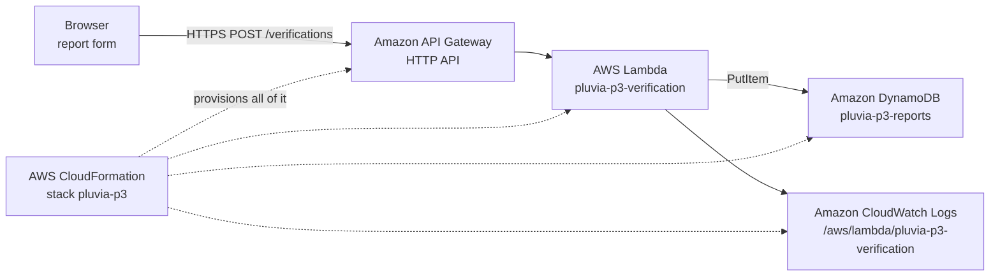

# PLUVIA

**Know the Impact, Not Just the Rain.**

A weather app tells you it rained 40 mm. It does not tell you that the corner you walk past
every morning held nineteen inches of water for almost five hours, and that the same corner
has done it on ten of the last twenty-five heavy rain days.

PLUVIA answers that second question, and only from records that already exist.

---

## What it does

1. **Find your location.** Zoom the map to your street and click it, or search a ZIP code,
   borough or street name. PLUVIA ranks the FloodNet sensors around that point by distance,
   or by how often they have actually flooded.

2. **See what was recorded there.** Every sensor carries its real history: how many separate
   days it measured standing water, the deepest reading, how long the water took to drain,
   and the date the last flood finished.

3. **Run a scenario against that history.** Choose a rain amount and a duration. PLUVIA counts
   the rain days since that sensor was installed, counts how many of those days it recorded
   water, and divides. The answer is a percentage of comparable days, not a prediction.

4. **Read the rows behind the answer.** One click expands the individual records: date,
   rainfall in millimetres, hours of rain, peak depth, drain time, and the nearby 311 drainage
   complaints with the date the city recorded the work as done.

5. **Replay one storm minute by minute.** For events that carry a stored depth profile, the
   timeline plays back from the recorded values at the recorded timestamps.

6. **Add what the sensors cannot see.** A sensor measures one point. The verification form
   lets a person who was there record what they saw, through a live AWS endpoint.

---

## Why there is no prediction model

Instead of predicting flooding, PLUVIA shows what one storm actually did to one place,
assembled from verified, dated public data.

No prediction, no warnings, no real-time claims. The scenario check is an arithmetic statement
about the past: *of the N comparable rain days since this sensor was installed, water was
recorded on M of them.* Every input to that sentence is on screen and every row is readable.

This is a deliberate product decision, not a missing feature. A flood warning that cannot be
validated is worse than no warning at all.

---

## What it refuses to do

| Situation | What PLUVIA says |
| --- | --- |
| Tidally influenced sensor | **Rain scenario refused.** Water here is driven by the tide. Beach 84 St has 388 recorded flood days, but the median rainfall on those days was 0.6 mm. A rainfall verdict there would be a confident number from the wrong cause. |
| Sensor with no recorded history | **Verdict unavailable.** A sensor with no history is not the same as a safe location. |
| Rain day count below 20 | The percentage is shown with an explicit caution that the evidence is thin. |
| Any missing value | Rendered as `[UNKNOWN]` or `Unavailable`. Never zero-filled, never interpolated. |

---

## Where AWS is used

The community verification layer runs on AWS, deployed as a single CloudFormation stack in
`ap-southeast-2`.



| Service | What it does here |
| --- | --- |
| **AWS CloudFormation** | One stack, `pluvia-p3`, provisions all nine resources. `CREATE_COMPLETE` in 53 seconds. |
| **Amazon API Gateway** | HTTP API with a single `POST /verifications` route, CORS locked to one configured origin. |
| **AWS Lambda** | Validates the payload against two fixed allowlists, rejects unknown keys, mints a receipt ID. Reserved concurrency 5. |
| **Amazon DynamoDB** | Stores the report under `EVENT#<id>` / `REPORT#<timestamp>#<receipt>` with a 30 day TTL. |
| **Amazon CloudWatch Logs** | Every request logged with its request ID, duration and memory. |

### Proof captured from the live stack

| Check | Result |
| --- | --- |
| Valid report | `201` with receipt `69c83988-f6ef-47ee-ba6c-020eb18cf549` |
| Invalid event id | `400 {"error":"invalid_event_id"}`, nothing written |
| DynamoDB item | `expiresAt` exactly 30 days after `receivedAt` |
| Lambda cold start | 6010.36 ms, init 81.05 ms |
| Lambda warm | 33.24 ms, 95 MB of 128 MB |

The endpoint URL is deliberately not published in this repository.

### Honest note on the open endpoint

`POST /verifications` uses `AuthorizationType: NONE`, because asking a flooded neighbour to
create an account is the wrong trade. It is contained by six controls: two fixed allowlists,
rejection of unknown keys, 10 rps with a burst of 20, reserved concurrency of 5, no personal
data with a 30 day TTL, and a billing alert.

The scenario arithmetic currently runs in the browser against a dated snapshot. Moving that
step into the same Lambda is the next piece of work, and the rule is already written as pure
functions so it moves without a rewrite.

---

## Data, and where every number comes from

Everything is a frozen, dated snapshot of public data. Nothing is fetched live at page load.

| Source | Dataset | What it provides |
| --- | --- | --- |
| NYC Open Data | `kb2e-tjy3` | 491 FloodNet sensors with coordinates, street, ZIP, install date, tidal flag |
| NYC Open Data | `aq7i-eu5q` | 3,420 recorded flood events across 318 sensors, 2021-01-16 to 2026-09-28 |
| NYC Open Data | `aq7i-eu5q` | Minute-by-minute depth profiles for the selected replay events |
| NYC Open Data | `erm2-nwe9` | 311 drainage service requests with their closed dates |
| Open-Meteo | historical archive | 2,109 days of rainfall and rain hours, 2021-01-01 to 2026-10-10 |

`data/nyc/MANIFEST.json` carries a SHA-256 for each captured file. `app/build_card_data.py`
verifies those hashes before it will build anything, and refuses on a mismatch.

Borough outlines in `app/nyc_boroughs.geojson` are a simplified public boundary file,
drawn so the map still reads as New York City when street tiles cannot be reached.

---

## Run it locally

```bash
python3 app/build_card_data.py
python3 -m http.server 8000
```

- Map and scenario view: <http://localhost:8000/app/index.html>
- Verification form: `http://localhost:8000/aws/form.html?api=<your ApiUrl>`

Deploying your own copy of the AWS stack is described in `aws/README.md`, with the
captured console walkthrough and outputs in `aws/DEPLOY_LOG.md`.

---

## Repository layout

| Path | Contents |
| --- | --- |
| `app/` | The map, scenario check, replay and evidence card |
| `app/build_card_data.py` | Snapshot verification and the whole join pipeline |
| `aws/` | CloudFormation template, Lambda handler, report form, deployment log |
| `data/nyc/` | Dated snapshots, QC log and the hash manifest |

---

## Licence

MIT. Leaflet 1.9.4 is vendored under `app/vendor/leaflet/` with its own BSD-2-Clause
licence. Map tiles are served by third parties and are background context only.
